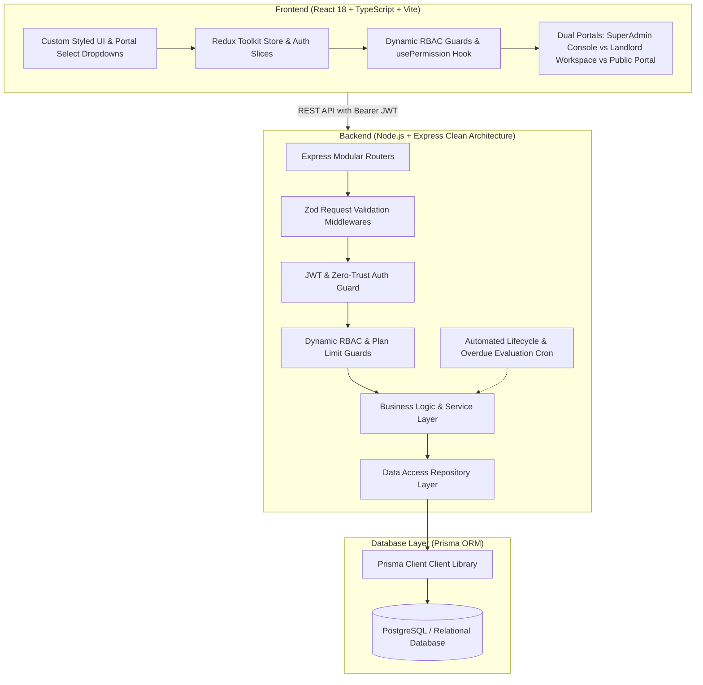

# 🏢 RentMate — Complete System Architecture & Project Documentation
> **Smarter Rentals. Happier Living.**  
> Comprehensive Technical Blueprint, Architecture, Database Schema, Zod Validation Engine, RBAC Matrix, Lifecycle Workflows, and REST API Reference.

---

## 📑 Table of Contents
1. [Executive Overview](#1-executive-overview)
2. [High-Level Architecture](#2-high-level-architecture)
3. [Technology Stack](#3-technology-stack)
4. [Multi-Tenant & SaaS Architecture](#4-multi-tenant--saas-architecture)
5. [Authentication & Zero-Trust Security Gate](#5-authentication--zero-trust-security-gate)
6. [Dynamic Role-Based Access Control (RBAC)](#6-dynamic-role-based-access-control-rbac)
7. [Comprehensive Module Breakdown](#7-comprehensive-module-breakdown)
8. [End-to-End Request Validation Engine (Zod Layer)](#8-end-to-end-request-validation-engine-zod-layer)
9. [Database Schema & Prisma Models](#9-database-schema--prisma-models)
10. [Complete REST API Reference](#10-complete-rest-api-reference)
11. [Automated Testing & Quality Assurance](#11-automated-testing--quality-assurance)
12. [Audit Timestamps & Lifecycle Tracking](#12-audit-timestamps--lifecycle-tracking)
13. [Pre-Configured Test Credentials & Accounts](#13-pre-configured-test-credentials--accounts)
14. [Local Setup, Seeding & Deployment Guide](#14-local-setup-seeding--deployment-guide)

---

## 1. Executive Overview

**RentMate** is an enterprise-grade, multi-tenant Property Management System (PMS) and SaaS platform engineered for property owners, real estate landlords, PG/commercial operators, and platform administrators.

### Core Problems Solved:
- **Centralized Multi-Unit Portfolio Management**: Multi-unit and building hierarchy with individual unit status tracking (`VACANT`, `OCCUPIED`, `MAINTENANCE`, `LISTED`).
- **Sub-Meter Utility Billing**: Independent electricity and water meter reading logs with automated consumption and cost calculations.
- **Rental Marketplace & Applications Pipeline**: Public listing portal (`/rentals`) with direct applicant lead submission and landlord approval workflows.
- **Automated Digital Lease Agreements**: Instant digital lease generation with customizable rent schedule rules, grace periods, and late fee penalties (per-day, fixed, percentage).
- **Maintenance Ticketing Engine**: Tenant complaints, priority levels, repair cost tracking, and status transitions.
- **Direct SuperAdmin Helpdesk**: Real-time communication channel between landlords/tenants and platform SuperAdmin.
- **Multi-Tenant SaaS Isolation**: Strict database partitioning by `organizationId` with tiered SaaS plans (`Trial`, `Starter`, `Pro`, `Enterprise`).
- **Zero-Trust Security**: Unified passwordless mobile OTP authentication gate with pre-registration checks.
- **Strict Input Validation**: End-to-end Zod request schema validation across all backend endpoints combined with custom reactive frontend UI controls.

---

## 2. High-Level Architecture

RentMate follows a clean decoupled **Client-Server Architecture** with strict layer separation:



---

## 3. Technology Stack

### Frontend (`/clint`)
- **Core**: React 18, TypeScript, Vite 5.4.
- **State Management**: Redux Toolkit (`@reduxjs/toolkit`) for global authentication, active organization, and session state.
- **Routing**: React Router v6 with protected route wrappers (`RequireAuth`, `RequireSuperAdmin`).
- **Styling & UI**: Vanilla CSS + Tailwind CSS, custom glassmorphism design tokens, micro-interactions, responsive grids.
- **UI Components**: Custom Portal-based `<Select>` dropdowns, modal dialogs, date pickers, toast notifications, inline error badges.
- **Document Generation**: jsPDF + AutoTable for branded legal rental agreements and rent receipts.
- **Icons**: Lucide React.
- **HTTP Client**: Axios with automatic JWT Bearer injection and standardized error interceptors.

### Backend (`/server`)
- **Runtime**: Node.js (v20+ LTS, ES Modules).
- **Framework**: Express.js with native async error handling.
- **Validation**: Zod schema validation middleware (`validateRequest`, `validateQuery`, `validateParams`).
- **ORM & Database**: Prisma ORM with PostgreSQL.
- **Authentication**: Signed JSON Web Tokens (JWT) + 6-digit cryptographic mobile OTP.
- **Logging**: Pino high-performance structured JSON logging.
- **Automation**: Node-cron background jobs for automated lease expiration, overdue rent assessment, and late-fee calculations.
- **Testing**: Jest test runner with 12 complete test suites (105 tests).

---

## 4. Multi-Tenant & SaaS Architecture

### Multi-Tenancy Hierarchy
1. **Platform Layer (Global SuperAdmin)**:
   - Oversees all Organizations, SaaS Subscription Plans, Platform RBAC roles, and system-wide telemetry.
   - Accesses `/superadmin` (Overview, Organizations, Plans, Roles, Users, Telemetry, Settings, Inquiries).
2. **Organization Layer (Tenant Boundary)**:
   - Each Landlord/Business operates in an isolated `Organization` (identified by a unique slug, e.g. `bharat-estates`).
   - Every property, unit, tenant, lease, and payment is strictly partitioned by `organizationId`.
3. **Workspace RBAC Layer (Staff & Team)**:
   - Organization Owners can create custom roles (e.g., "Property Manager", "Accountant") and assign team members with specific property scopes.

### SaaS Subscription Plans & Limits
- **Plan Guard (`plan.guard.js`)**:
  - Enforces property, unit, and staff quotas based on active plan limits.
  - Automatically exempts SuperAdmin platform accounts from quota restrictions.

---

## 5. Authentication & Zero-Trust Security Gate

RentMate implements a **Passwordless Zero-Trust Mobile OTP Authentication Architecture**:

1. **Pre-Registration Gate**:
   - The user enters a 10-digit Indian mobile number (`/^[6-9]\d{9}$/`).
   - `auth.service.js` checks `userRepo.findByMobile(mobile)`. If not registered, the system returns `403 Forbidden`, blocking bot abuse.
2. **Cryptographic OTP Generation**:
   - A 6-digit OTP is generated with a 5-minute TTL.
   - In development mode, the OTP is printed to the console and returned as `devOtp` for seamless 1-click verification.
3. **JWT Issuance & Portal Routing**:
   - Upon successful verification, a signed JWT token is issued.
   - SuperAdmin users receive a switcher modal to choose between the **SuperAdmin Console** and the **Landlord Workspace**.

---

## 6. Dynamic Role-Based Access Control (RBAC)

### A. Platform Permissions (SuperAdmin Level)
| Permission Key | Display Name | Purpose |
|:---|:---|:---|
| `PLATFORM_MANAGE_ORGS` | Organization Control | Create, update, suspend client organizations |
| `PLATFORM_MANAGE_PLANS` | SaaS Plans | Create, edit, and adjust pricing and quota limits |
| `PLATFORM_MANAGE_ROLES` | Platform RBAC | Define platform roles and administrative rights |
| `PLATFORM_MANAGE_USERS` | User Directory | Audit platform accounts, toggle user active/suspended state |
| `PLATFORM_VIEW_METRICS` | System Metrics | View real-time telemetry, server health, and memory |
| `PLATFORM_SECURITY` | Security Console | Zero-trust audit logs and security settings |

### B. Workspace Permissions (Tenant/Landlord Level)
| Permission Key | Display Name | Purpose |
|:---|:---|:---|
| `property.read` / `property.create` / `property.update` / `property.delete` | Property Management | Browse, add, edit, or delete buildings |
| `unit.read` / `unit.create` / `unit.update` / `unit.delete` | Unit Management | Manage individual flats, rooms, shops |
| `tenant.read` / `tenant.create` / `tenant.update` | Tenant Management | Onboard tenants and update profiles |
| `lease.read` / `lease.create` / `lease.update` / `lease.terminate` | Lease Management | Create agreements, activate digital leases |
| `payment.read` / `payment.create` / `payment.update` | Payment Management | Log rent, issue bills, record cash/UPI transactions |
| `maintenance.read` / `maintenance.create` / `maintenance.update` | Maintenance Management | Raise, assign, and resolve maintenance tickets |
| `role.assign` / `team.manage` | Team Management | Invite staff members and assign property scopes |
| `report.read` | Reports & Export | Download financial and occupancy CSV/PDF summaries |

---

## 7. Comprehensive Module Breakdown

### Module 1: Auth & Session Management (`/login`, `/register`)
- 10-digit Indian mobile format validation (`/^[6-9]\d{9}$/`).
- 1-Click Quick Demo Login Badges (SuperAdmin `9876543210`, Staff `9876543222`).
- 6 individual auto-advancing OTP input boxes with backspace and clipboard paste support.

### Module 2: Dashboard & Overview (`/`)
- Real-time KPI summary cards: Total Properties, Occupied vs Vacant Units, Active Tenants, Monthly Rent Collected, Overdue Invoices.
- Revenue trends, occupancy analytics, and recent activity feed.

### Module 3: Properties & Units (`/properties`)
- Full building CRUD + multi-unit management.
- Unit bulk generator (floors and units per floor).
- Sub-meter reading modals for electricity and water utility management.

### Module 4: Rentals Marketplace (`/rentals`)
- Public listing showcase with search, city filters, and bedroom counts.
- Prospective tenant application modal with instant landlord notification.

### Module 5: Rental Applications & Digital Lease (`/applications`)
- Application pipeline with status filters (`PENDING`, `APPROVED`, `REJECTED`).
- One-click approval modal that activates a digital lease, marks the unit `OCCUPIED`, and sets automated penalty rules.

### Module 6: Tenants Management (`/tenants`)
- Complete tenant profiles, linked unit, lease dates, monthly rent, and payment history.
- Indian mobile validation, email validation, and direct phone dialer.

### Module 7: Payments & Ledger (`/payments`)
- Rent collection tracking with partial payments, UPI, Cash, and Bank Transfer options.
- Automated utility billing integration and downloadable PDF receipts.

### Module 8: Maintenance Complaints (`/maintenance`)
- Ticket tracking with category (`PLUMBING`, `ELECTRICAL`, `CARPENTRY`, `OTHER`), priority (`LOW`, `MEDIUM`, `HIGH`, `URGENT`), and cost tracking.

### Module 9: Messages & Helpdesk (`/messages`, `/contact`, Support Modal)
- Direct support channel connecting visitors, tenants, and landlords with SuperAdmin.
- SuperAdmin reply thread and ticket lifecycle management (`UNREAD`, `READ`, `IN_PROGRESS`, `RESOLVED`, `ARCHIVED`).

### Module 10: SuperAdmin Console (`/superadmin/*`)
- Central command center: Overview, Client Organizations, SaaS Plans, Platform Roles, User Directory, System Telemetry, and Platform Dynamic Settings.

---

## 8. End-to-End Request Validation Engine (Zod Layer)

RentMate enforces strict validation at both backend route boundaries and frontend form controls:

### Backend Zod Middleware Architecture:
Located in `server/src/common/validators/`:
- **`request.validator.js`**: `validateRequest(schema)`, `validateQuery(schema)`, `validateParams(schema)` middlewares.
- **`property.validator.js`**: Title (min 3 chars), address, city, rent > 0, bedrooms >= 0.
- **`unit.validator.js`**: Unit number required, rentAmount > 0, depositAmount >= 0; meter reading non-negative, ratePerUnit > 0.
- **`tenant.validator.js`**: Name (min 2 chars), RFC email format, Indian phone `/^[6-9]\d{9}$/`.
- **`payment.validator.js`**: TenantId required, amount > 0, month format `YYYY-MM`.
- **`maintenance.validator.js`**: Title (min 3 chars), category & priority enums, repair cost >= 0.
- **`application.validator.js`**: Applicant name, Indian phone `/^[6-9]\d{9}$/`, dueDay (1–28), graceDays (0–15), penalty rules.
- **`listing.validator.js`**: Title (min 3 chars), rent > 0, security deposit >= 0.
- **`message.validator.js`**: Sender name, mobile `/^[6-9]\d{9}$/`, subject, priority, reply message.
- **`organization.validator.js`**: Name (min 2 chars), slug format, ownerMobile `/^[6-9]\d{9}$/`, utility rates >= 0.
- **`plan.validator.js`**: Plan name (min 2 chars), prices >= 0, quota limits (properties/tenants/staff >= 1).
- **`admin.validator.js`**: User registration mobile `/^[6-9]\d{9}$/`, role definition, system setting key regex `/^[a-z0-9_]+$/`.

### Frontend Custom UI Dropdowns:
- All native HTML `<select>` elements have been replaced with the custom portal-based `<Select>` component (`clint/src/components/ui/input.tsx`).
- Renders to `document.body` via React Portals with smooth animations, active indicators, rotated chevrons, and keyboard navigation.

---

## 9. Database Schema & Prisma Models

Primary relational models defined in `server/prisma/schema.prisma`:

```prisma
model User {
  id           String        @id @default(cuid())
  mobile       String        @unique
  name         String?
  email        String?       @unique
  status       UserStatus    @default(ACTIVE)
  isSuperAdmin Boolean       @default(false)
  adminRole    String?
  createdAt    DateTime      @default(now())
  updatedAt    DateTime      @updatedAt
  memberships  OrgMember[]
  roles        UserRole[]
  properties   Property[]
  leases       Lease[]
}

model Organization {
  id          String        @id @default(cuid())
  name        String
  slug        String        @unique
  planId      String?
  status      OrgStatus     @default(ACTIVE)
  electricityRate Float     @default(8.5)
  waterRate       Float     @default(15.0)
  createdAt   DateTime      @default(now())
  updatedAt   DateTime      @updatedAt
  members     OrgMember[]
  properties  Property[]
  tenants     Tenant[]
  leases      Lease[]
}

model Plan {
  id            String       @id @default(cuid())
  code          String       @unique
  name          String
  priceMonthly  Float        @default(0)
  priceYearly   Float        @default(0)
  maxProperties Int          @default(10)
  maxTenants    Int          @default(50)
  maxStaff      Int          @default(5)
  features      String?
  createdAt     DateTime     @default(now())
  updatedAt     DateTime     @updatedAt
}

model Property {
  id             String       @id @default(cuid())
  title          String
  address        String
  city           String
  rent           Float
  bedrooms       Int          @default(1)
  status         PropStatus   @default(VACANT)
  organizationId String
  createdAt      DateTime     @default(now())
  updatedAt      DateTime     @updatedAt
  units          Unit[]
  tenants        Tenant[]
  payments       Payment[]
}

model Unit {
  id             String       @id @default(cuid())
  propertyId     String
  unitNumber     String
  type           String       @default("1BHK")
  rentAmount     Float
  depositAmount  Float        @default(0)
  status         UnitStatus   @default(VACANT)
  createdAt      DateTime     @default(now())
  updatedAt      DateTime     @updatedAt
  leases         Lease[]
  meterReadings  MeterReading[]
}

model Lease {
  id             String       @id @default(cuid())
  organizationId String
  propertyId     String
  unitId         String
  tenantId       String
  startDate      DateTime
  endDate        DateTime?
  monthlyRent    Float
  depositAmount  Float        @default(0)
  dueDay         Int          @default(5)
  graceDays      Int          @default(3)
  lateFeeRule    String       @default("PER_DAY")
  lateFeeAmount  Float        @default(50)
  maxLateFeeCap  Float        @default(1500)
  status         LeaseStatus  @default(ACTIVE)
  createdAt      DateTime     @default(now())
  updatedAt      DateTime     @updatedAt
  payments       Payment[]
}
```

---

## 10. Complete REST API Reference

All protected endpoints require the `Authorization: Bearer <JWT>` header.

### Authentication (`/api/v1/auth`)
| Method | Endpoint | Description | Access |
|:---|:---|:---|:---|
| `POST` | `/auth/otp/send` | Send 6-digit OTP to pre-registered mobile | Public (Strict Mobile Gate) |
| `POST` | `/auth/otp/verify` | Verify OTP and receive signed JWT token | Public |
| `GET` | `/auth/me` | Fetch authenticated user profile & permissions | Bearer Token |

### Properties & Units (`/api/v1/properties`, `/api/v1/units`)
| Method | Endpoint | Description | Validation |
|:---|:---|:---|:---|
| `GET` | `/properties` | List organization properties | JWT |
| `POST` | `/properties` | Create new building property | `createPropertySchema` |
| `PUT` | `/properties/:id` | Update property details | `updatePropertySchema` |
| `DELETE` | `/properties/:id` | Delete property | Param UUID |
| `GET` | `/units/property/:propertyId` | List units under a property | JWT |
| `POST` | `/units` | Create individual unit | `createUnitSchema` |
| `POST` | `/units/bulk` | Bulk generate units per floor | `bulkCreateUnitsSchema` |
| `POST` | `/units/:id/meter` | Record sub-meter reading | `recordMeterReadingSchema` |

### Applications & Marketplace (`/api/v1/applications`, `/api/v1/listings`)
| Method | Endpoint | Description | Validation |
|:---|:---|:---|:---|
| `GET` | `/listings/public` | List public marketplace rental units | Public |
| `POST` | `/applications/public` | Submit rental application | `submitApplicationSchema` |
| `GET` | `/applications/owner` | List applications for landlord | JWT |
| `POST` | `/applications/:id/approve` | Approve application & activate lease | `approveApplicationSchema` |
| `POST` | `/applications/:id/reject` | Reject rental application | Param ID |

### Tenants & Leases (`/api/v1/tenants`, `/api/v1/leases`)
| Method | Endpoint | Description | Validation |
|:---|:---|:---|:---|
| `GET` | `/tenants` | List all active/inactive tenants | JWT |
| `POST` | `/tenants` | Onboard tenant and link to property | `createTenantSchema` |
| `PUT` | `/tenants/:id` | Update tenant details | `updateTenantSchema` |
| `GET` | `/leases` | List digital lease agreements | JWT |
| `POST` | `/leases/:id/terminate` | Terminate active lease | Param ID |

### Payments & Invoicing (`/api/v1/payments`)
| Method | Endpoint | Description | Validation |
|:---|:---|:---|:---|
| `GET` | `/payments` | List rent collection logs | JWT |
| `POST` | `/payments` | Record new rent payment | `createPaymentSchema` |
| `GET` | `/payments/:id/receipt` | Generate official rent receipt | JWT |

### Maintenance Tickets (`/api/v1/maintenance`)
| Method | Endpoint | Description | Validation |
|:---|:---|:---|:---|
| `GET` | `/maintenance` | List complaints for workspace | JWT |
| `POST` | `/maintenance` | Raise new maintenance ticket | `createMaintenanceSchema` |
| `PUT` | `/maintenance/:id/status` | Update ticket status & cost | `updateMaintenanceSchema` |

### Messages & Support Desk (`/api/v1/messages`)
| Method | Endpoint | Description | Validation |
|:---|:---|:---|:---|
| `POST` | `/messages/submit` | Submit visitor or tenant inquiry | `submitMessageSchema` |
| `GET` | `/messages/my` | List messages submitted by current user | JWT |
| `GET` | `/messages/all` | List all messages for SuperAdmin | `PLATFORM_SECURITY` |
| `POST` | `/messages/:id/reply` | Reply to inquiry as SuperAdmin | `replyMessageSchema` |
| `PUT` | `/messages/:id/status` | Update message status | `updateMessageStatusSchema` |

### SuperAdmin Management (`/api/v1/admin/*`)
| Method | Endpoint | Description | Permission Required |
|:---|:---|:---|:---|
| `GET` | `/admin/metrics` | Platform vitals & financial metrics | `PLATFORM_VIEW_METRICS` |
| `GET` | `/admin/organizations` | List all client organizations | `PLATFORM_MANAGE_ORGS` |
| `POST` | `/admin/organizations` | Provision new client organization | `createOrganizationSchema` |
| `GET` | `/admin/plans` | List SaaS subscription plans | `PLATFORM_MANAGE_PLANS` |
| `POST` | `/admin/plans` | Create SaaS subscription tier | `createPlanSchema` |
| `GET` | `/admin/settings` | List dynamic platform settings | `PLATFORM_SECURITY` |
| `POST` | `/admin/settings` | Create dynamic system variable | `createSettingSchema` |
| `PUT` | `/admin/settings/:key` | Update system variable | `updateSettingSchema` |

---

## 11. Automated Testing & Quality Assurance

RentMate features a complete Jest automated test suite verifying every domain rule, security policy, and edge case:

```bash
# Run test suite in server directory
npm test
```

### Test Suite Summary:
- **Total Test Suites**: 12 passed, 12 total
- **Total Test Cases**: 105 passed, 105 total (100% success rate, 0 failures)
- **Coverage Areas**:
  1. `comprehensive_validation_and_security.test.js`: Request validation error codes, sanitization, negative numbers, bad phone numbers.
  2. `admin_and_roles.test.js`: SuperAdmin role definitions and system variable guards.
  3. `multi_tenant_isolation.test.js`: Cross-tenant data leak prevention.
  4. `real_life_edge_cases.test.js`: Sub-meter rollovers, partial rent payments, duplicate phone prevention.
  5. `modules.test.js`: Property, unit, and tenant CRUD operations.
  6. `brd_trd_lifecycle.test.js`: Full application-to-lease activation and automated late fee penalty calculations.
  7. `rbac.test.js`: Permission authorization engines.
  8. `superadmin_rbac_and_plans.test.js`: SaaS quota limits and tier transitions.
  9. `auth.test.js`: Pre-registration check, OTP generation, and JWT issuance.
  10. `messages.test.js`: Support message ticketing and SuperAdmin replies.
  11. `app.test.js`: Server boot and health probes.
  12. `user.test.js`: User profiles and status toggling.

---

## 12. Audit Timestamps & Lifecycle Tracking

Every entity in the database automatically retains ISO 8601 audit timestamps (`createdAt` and `updatedAt`).

In `clint/src/lib/utils.ts`, the centralized helper `formatDateTime` formats timestamps into Indian Standard Time (IST):
```typescript
export function formatDateTime(dateStr?: string | Date | null): string {
  if (!dateStr) return "N/A";
  const d = new Date(dateStr);
  return d.toLocaleString("en-IN", {
    day: "2-digit",
    month: "short",
    year: "numeric",
    hour: "2-digit",
    minute: "2-digit",
    hour12: true,
  });
}
// Example Output: "21 Oct 2026, 06:15 AM"
```

---

## 13. Pre-Configured Test Credentials & Accounts

The database includes active seed accounts for instant testing:

| Role | Mobile Number | Name | Email | Privileges |
|:---|:---|:---|:---|:---|
| 👑 **SuperAdmin & Owner** | `9876543210` | Bharat | `bharat@rentmate.local` | Full platform admin + Owner of "Bharat Estates" |
| 🛡️ **Master Platform Admin** | `8003953815` | Bharat Kumar | `bharatpareek256@gmail.com` | Root SuperAdmin privileges |
| 🏢 **Property Staff** | `9876543222` | Sunil Kumar | `sunil@bharatestates.local` | Standard workspace access with property scope |
| 👤 **Renter / Tenant** | `9876543233` | Rahul Sharma | `rahul@gmail.com` | Tenant portal access |

> 💡 **Demo OTP Feature**: In development mode, the verification code is automatically printed to the terminal console and pre-filled in the frontend OTP input. Simply click **"Verify & Sign In"**!

---

## 14. Local Setup, Seeding & Deployment Guide

### 1. Prerequisites
- **Node.js**: v18.18.0 or higher (Recommended: Node v20 LTS)
- **npm**: v9.0.0 or higher
- **PostgreSQL**: Running locally or on cloud (Supabase, Neon, AWS RDS)

### 2. Backend Setup (`/server`)
```bash
cd server
npm install
npx prisma db push
npx prisma generate
node prisma/seed.js
npm run dev
```
Backend starts on `http://localhost:5000`.

### 3. Frontend Setup (`/clint`)
```bash
cd clint
npm install
npm run dev
```
Frontend starts on `http://localhost:5173`.

### 4. Running Verification Commands
```bash
# In /server: Run 105 automated tests
npm test

# In /clint: Run production build and TypeScript check
npm run build
```
