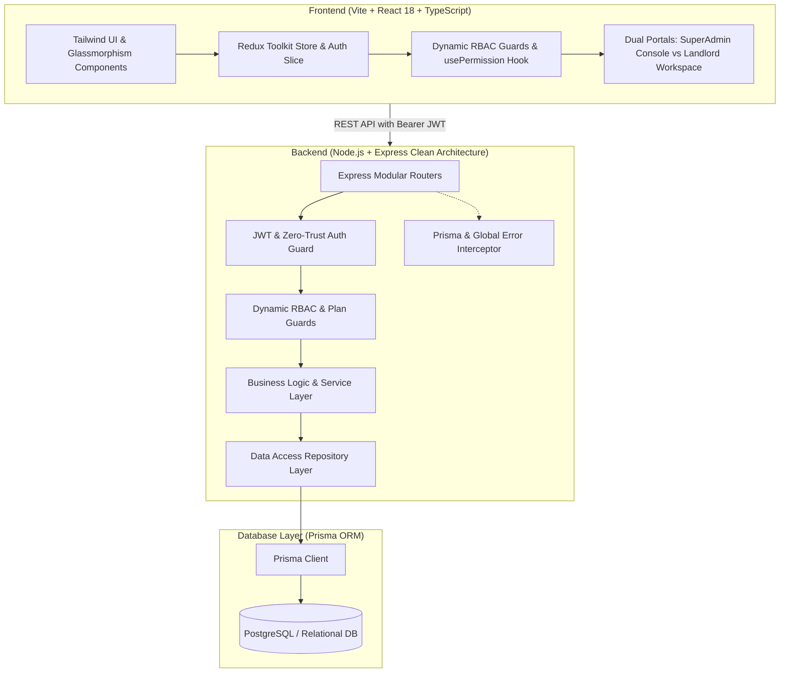

# 🏢 RentMate — Complete System Architecture & Project Documentation
> **Smarter Rentals. Happier Living.**  
> Comprehensive Line-by-Line Technical Blueprint, Architecture, Database Schema, RBAC Matrix, and API Reference.

---

## 📑 Table of Contents
1. [Executive Overview](#1-executive-overview)
2. [High-Level Architecture](#2-high-level-architecture)
3. [Technology Stack](#3-technology-stack)
4. [Multi-Tenant & SaaS Architecture](#4-multi-tenant--saas-architecture)
5. [Authentication & Zero-Trust Security Gate](#5-authentication--zero-trust-security-gate)
6. [Dynamic Role-Based Access Control (RBAC)](#6-dynamic-role-based-access-control-rbac)
7. [Comprehensive Module Breakdown (10 Modules)](#7-comprehensive-module-breakdown-10-modules)
8. [Database Schema & Prisma Models](#8-database-schema--prisma-models)
9. [Complete REST API Reference](#9-complete-rest-api-reference)
10. [Audit Timestamps & Lifecycle Tracking](#10-audit-timestamps--lifecycle-tracking)
11. [Pre-Configured Test Credentials & Accounts](#11-pre-configured-test-credentials--accounts)
12. [Local Setup, Seeding & Testing Guide](#12-local-setup-seeding--testing-guide)

---

## 1. Executive Overview

**RentMate** is an enterprise-grade, multi-tenant Property Management System (PMS) and SaaS platform designed for property owners, landlords, real estate managers, and platform administrators.

### Core Problems Solved:
- **Centralized Property Management**: Multi-unit management with real-time occupancy and vacant tracking.
- **Tenant Lease Automation**: Digitally tracks tenant profiles, lease commencement, renewal, and expiry.
- **Payment & Rent Collection Tracking**: Logs monthly rent, partial payments, payment modes (UPI, Cash, Bank Transfer), and tracks overdue payments.
- **Multi-Tenant SaaS Foundation**: Organizations operate in isolated tenant boundaries with tiered subscription plans (Trial, Starter, Pro, Enterprise).
- **Strict Zero-Trust Security**: Unified mobile OTP authentication where only pre-registered or invited accounts can log in, eliminating credential brute-forcing.
- **Granular RBAC**: Dynamic permission engines for both platform-wide administrators (SuperAdmins) and workspace-specific roles (Landlord, Manager, Staff, Accountant).

---

## 2. High-Level Architecture

RentMate follows a decoupled **Client-Server Architecture** with strict layer separation:



---

## 3. Technology Stack

### Frontend (`/clint`)
- **Runtime & Build**: [Vite 5.4](https://vitejs.dev/) with [React 18](https://react.dev/) & [TypeScript](https://www.typescriptlang.org/)
- **State Management**: [Redux Toolkit](https://redux-toolkit.js.org/) (`@reduxjs/toolkit`) for global auth, tokens, active portal, and user state
- **Routing**: [React Router v6](https://reactrouter.com/) with protected route wrappers (`RequireAuth`, `RequireSuperAdmin`)
- **Styling**: Vanilla CSS + [Tailwind CSS](https://tailwindcss.com/) with glassmorphism, responsive grids, and micro-interactions
- **Icons & Visuals**: [Lucide React](https://lucide.dev/)
- **API Communication**: Native `fetch` with centralized API clients and custom error handling

### Backend (`/server`)
- **Runtime**: [Node.js](https://nodejs.org/) (ES Modules)
- **Web Framework**: [Express.js](https://expressjs.com/)
- **ORM / Database**: [Prisma ORM](https://www.prisma.io/) with SQLite / PostgreSQL
- **Security & Tokens**: [JSON Web Tokens (JWT)](https://jwt.io/) & zero-trust OTP verification
- **Logging**: [Pino](https://getpino.io/) high-performance structured logging
- **Architecture**: Domain-driven Controller-Service-Repository pattern

---

## 4. Multi-Tenant & SaaS Architecture

### Multi-Tenancy Hierarchy
1. **Platform Layer (Global SuperAdmin)**:
   - Oversees all Organizations, SaaS Subscription Plans, and Platform RBAC roles.
   - Accesses `/superadmin` (System Overview, Organizations, SaaS Plans, Platform Roles, User Audit, Telemetry).
2. **Organization Layer (Tenant Boundary)**:
   - Each Landlord/Business owns an `Organization` (identified by a unique `slug`, e.g., `bharat-estates`).
   - Every property, tenant, and payment is strictly bound to an `organizationId`.
   - Data between organizations is completely isolated.
3. **Workspace RBAC Layer (Staff & Team)**:
   - Organization Owners can create custom roles (e.g., "Property Manager", "Leasing Agent", "Accountant") and assign team members with specific property scopes.

### SaaS Subscription Plans & Limits
- **Plan Guard (`plan.guard.js`)**:
  - Enforces property and unit limits based on the organization's active plan.
  - E.g., `Starter Plan` allows up to 10 properties, while `Enterprise` provides unlimited capacity.
  - Automatically exempts SuperAdmin accounts from plan limits.

---

## 5. Authentication & Zero-Trust Security Gate

RentMate implements a **Zero-Trust Mobile OTP Authentication Architecture**:

### The Strict Pre-Registration Gate
1. **User Enters 10-Digit Mobile**:
   - The user inputs their mobile number on `/login`.
2. **Database Verification**:
   - `auth.service.js` checks `userRepo.findByMobile(mobile)`.
   - **If the user does NOT exist**: The system rejects the request with HTTP `403`:
     > *"Mobile number is not registered on RentMate. Please enter a registered number or contact your administrator."*
   - This ensures arbitrary strangers or malicious bots cannot trigger OTP SMS endpoints.
3. **OTP Generation & Verification**:
   - A 6-digit cryptographically secure OTP is generated with a 5-minute TTL.
   - In Development / Test environments, the OTP is printed to the server console and returned as `devOtp` for instant one-click testing.
4. **JWT Issuance**:
   - Upon successful 6-digit OTP verification, a signed JWT token is issued containing `userId`, `mobile`, `adminRole`, and `isSuperAdmin`.
5. **Smart Dual-Portal Switcher**:
   - If the user has `isSuperAdmin: true`, a modal asks them to choose between:
     - 🏢 **Property & Rental Workspace** (Standard Landlord UI)
     - 🛡️ **SuperAdmin Console** (Platform Master Controls)
   - Normal users are immediately directed to their organization dashboard.

---

## 6. Dynamic Role-Based Access Control (RBAC)

RentMate features two separate layers of RBAC:

### A. Platform Permissions (SuperAdmin Level)
| Permission Key | Display Name | Purpose |
|:---|:---|:---|
| `PLATFORM_MANAGE_ORGS` | Organization Control | Create, update, suspend client organizations |
| `PLATFORM_MANAGE_PLANS` | SaaS Plans | Create, edit, and adjust pricing/limits of subscription tiers |
| `PLATFORM_MANAGE_ROLES` | Platform RBAC | Define platform roles and their granular privileges |
| `PLATFORM_MANAGE_USERS` | User Directory | Audit platform accounts, activate/suspend registered users |
| `PLATFORM_VIEW_METRICS` | System Metrics | View real-time telemetry, server health, memory, and database stats |
| `PLATFORM_SECURITY` | Security Console | Zero-trust audit logs and security settings |

### B. Workspace Permissions (Tenant/Landlord Level)
| Permission Key | Display Name | Purpose |
|:---|:---|:---|
| `PROPERTY_VIEW` | View Properties | Browse rental units and property details |
| `PROPERTY_MANAGE` | Manage Properties | Create, edit, or delete rental listings |
| `TENANT_VIEW` | View Tenants | Access tenant profiles and lease records |
| `TENANT_MANAGE` | Manage Tenants | Add new tenants, renew leases, or update contracts |
| `PAYMENT_VIEW` | View Payments | View financial statements and rent invoices |
| `PAYMENT_COLLECT` | Collect Payments | Log rent receipts, record cash/UPI transactions |
| `TEAM_MANAGE` | Manage Team | Invite team members and configure workspace roles |
| `REPORTS_EXPORT` | Export Reports | Download financial and occupancy CSV/PDF summaries |

### Frontend UI Enforcement
- **`usePermission(permissionKey)`**: Hook returns `true` or `false` based on user token capabilities.
- **`<HasPermission permission="...">`**: Conditionally renders UI elements, action buttons, or whole tabs.
- If a user lacks a permission, the corresponding navigation link or action button is automatically hidden or disabled.

---

## 7. Comprehensive Module Breakdown (10 Modules)

### Module 1: Auth & Session Management (`/login`, `/register`)
- Unified 10-digit mobile number input with Indian format validation (`+91`).
- 1-Click **Quick Demo Login Badges**:
  - 👑 SuperAdmin & Owner (`9876543210`)
  - 🏢 Property Staff (`9876543222`)
- 6 individual auto-advancing OTP input boxes with backspace and paste support.
- Workspace selector modal for multi-role platform administrators.

### Module 2: Dashboard & Overview (`/`)
- Real-time KPI summary cards:
  - Total Properties & Units (Occupied vs Vacant)
  - Active Tenants
  - Monthly Rent Collection & Overdue Invoices
  - Occupancy Rate (%)
- Visual Revenue trend charts and recent transactions feed.
- Quick shortcut actions to add property, record rent, or register tenant.

### Module 3: Properties Management (`/properties`)
- Full CRUD operations on rental assets.
- Fields: Title, Address, City, State, Monthly Rent, Bedrooms, Bathrooms, Status (`OCCUPIED`, `VACANT`, `MAINTENANCE`).
- Filter properties by Occupancy Status and City.
- Enforces SaaS Plan property limits before allowing new unit creation.

### Module 4: Tenants Management (`/tenants`)
- Complete tenant lifecycle tracking.
- Fields: Full Name, Mobile Phone, Email, Associated Property Unit, Lease Start Date, Lease End Date, Monthly Rent Amount, Status (`ACTIVE`, `INACTIVE`).
- Quick-call action and direct link to tenant payment history.

### Module 5: Payments & Invoicing (`/payments`)
- Financial tracking of rent collections.
- Fields: Tenant, Property, Month/Year, Amount, Payment Method (`UPI`, `CASH`, `BANK_TRANSFER`, `CHEQUE`), Payment Date, Status (`PAID`, `PENDING`, `OVERDUE`).
- Downloadable/printable rent receipts with unique transaction reference IDs.

### Module 6: Organizations Management (`/superadmin/organizations`)
- Multi-tenant client management.
- Fields: Name, Unique Slug, Owner Mobile/Email, Assigned SaaS Plan, Status (`ACTIVE`, `SUSPENDED`).
- Dynamic organization switching and subscription tier assignment.

### Module 7: SaaS Plans Management (`/superadmin/plans`)
- Subscription configuration engine.
- Fields: Plan Code, Display Name, Monthly/Annual Price, Max Properties Limit, Max Team Members, Feature Toggles (Analytics, WhatsApp reminders, Priority support).
- Real-time client count per plan tier.

### Module 8: Platform Roles & RBAC (`/superadmin/roles`)
- Dynamic permission matrix management.
- Create custom platform and workspace roles with multi-select permission checkboxes.
- System roles (`SUPER_ADMIN`, `OWNER`) are protected from accidental deletion.

### Module 9: User & Team Management (`/superadmin/users` & `/settings/team`)
- Audit registered platform phone numbers.
- Toggle user account state (`ACTIVE` vs `SUSPENDED`).
- Workspace team invitation with role-based property scoping.

### Module 10: System Telemetry & Health (`/superadmin/telemetry`)
- Live system pulse:
  - Uptime in hours/minutes
  - Server latency (ms)
  - Active database connections
  - Memory consumption (RSS / Heap Used)
  - Request rate and error counts

---

## 8. Database Schema & Prisma Models

Here is the primary data structure defined in `server/prisma/schema.prisma`:

```prisma
// 1. User Account
model User {
  id           String        @id @default(cuid())
  mobile       String        @unique
  name         String?
  email        String?       @unique
  status       UserStatus    @default(ACTIVE)
  isSuperAdmin Boolean       @default(false)
  adminRole    String?
  createdAt    DateTime      @default(now())
  updatedAt    DateTime      @updatedAt
  memberships  OrgMember[]
  roles        UserRole[]
  properties   Property[]
}

// 2. Organization (Tenant)
model Organization {
  id          String        @id @default(cuid())
  name        String
  slug        String        @unique
  planId      String?
  status      OrgStatus     @default(ACTIVE)
  createdAt   DateTime      @default(now())
  updatedAt   DateTime      @updatedAt
  members     OrgMember[]
  properties  Property[]
  tenants     Tenant[]
}

// 3. SaaS Subscription Plan
model Plan {
  id            String       @id @default(cuid())
  code          String       @unique
  name          String
  priceMonthly  Float        @default(0)
  maxProperties Int          @default(10)
  features      String?      // JSON string of enabled feature flags
  createdAt     DateTime     @default(now())
  updatedAt     DateTime     @updatedAt
}

// 4. Rental Property
model Property {
  id             String       @id @default(cuid())
  title          String
  address        String
  city           String
  rent           Float
  bedrooms       Int          @default(1)
  status         PropStatus   @default(VACANT) // VACANT | OCCUPIED | MAINTENANCE
  organizationId String
  createdAt      DateTime     @default(now())
  updatedAt      DateTime     @updatedAt
  tenants        Tenant[]
  payments       Payment[]
}

// 5. Tenant Profile
model Tenant {
  id             String       @id @default(cuid())
  name           String
  phone          String
  email          String?
  leaseStart     DateTime
  leaseEnd       DateTime?
  propertyId     String
  organizationId String
  status         TenantStatus @default(ACTIVE)
  createdAt      DateTime     @default(now())
  updatedAt      DateTime     @updatedAt
  payments       Payment[]
}

// 6. Payment & Rent Receipt
model Payment {
  id             String        @id @default(cuid())
  amount         Float
  month          String        // e.g. "2026-10"
  method         PaymentMethod // CASH | UPI | BANK_TRANSFER
  status         PaymentStatus // PAID | PENDING | OVERDUE
  paidAt         DateTime?
  tenantId       String
  propertyId     String
  organizationId String
  createdAt      DateTime      @default(now())
  updatedAt      DateTime      @updatedAt
}
```

---

## 9. Complete REST API Reference

All requests must include `Authorization: Bearer <JWT>` header (except `/auth/otp/send` and `/auth/otp/verify`).

### Authentication & Sessions (`/api/v1/auth`)
| Method | Endpoint | Description | Access |
|:---|:---|:---|:---|
| `POST` | `/auth/otp/send` | Send 6-digit OTP to pre-registered mobile | Public (Strict Mobile Gate) |
| `POST` | `/auth/otp/verify` | Verify OTP and receive JWT token | Public |
| `GET` | `/auth/me` | Fetch authenticated user profile & permissions | Bearer Token |

### Organizations (`/api/v1/admin/organizations`)
| Method | Endpoint | Description | Permission Required |
|:---|:---|:---|:---|
| `GET` | `/admin/organizations` | List all organizations | `PLATFORM_MANAGE_ORGS` |
| `POST` | `/admin/organizations` | Create new organization & assign owner | `PLATFORM_MANAGE_ORGS` |
| `PUT` | `/admin/organizations/:id` | Update organization details / plan | `PLATFORM_MANAGE_ORGS` |
| `DELETE` | `/admin/organizations/:id` | Delete organization and cascade assets | `PLATFORM_MANAGE_ORGS` |

### SaaS Plans (`/api/v1/admin/plans`)
| Method | Endpoint | Description | Permission Required |
|:---|:---|:---|:---|
| `GET` | `/admin/plans` | Fetch all subscription plan tiers | Public / Authenticated |
| `POST` | `/admin/plans` | Create new SaaS plan tier | `PLATFORM_MANAGE_PLANS` |
| `PUT` | `/admin/plans/:id` | Update pricing or property limits | `PLATFORM_MANAGE_PLANS` |
| `DELETE` | `/admin/plans/:id` | Delete subscription plan | `PLATFORM_MANAGE_PLANS` |

### Platform Roles & RBAC (`/api/v1/admin/roles`)
| Method | Endpoint | Description | Permission Required |
|:---|:---|:---|:---|
| `GET` | `/admin/roles` | List all system & custom platform roles | `PLATFORM_MANAGE_ROLES` |
| `POST` | `/admin/roles` | Create new role with permission array | `PLATFORM_MANAGE_ROLES` |
| `PUT` | `/admin/roles/:id` | Modify role permissions or description | `PLATFORM_MANAGE_ROLES` |
| `DELETE` | `/admin/roles/:id` | Delete custom role | `PLATFORM_MANAGE_ROLES` |

### Properties (`/api/v1/properties`)
| Method | Endpoint | Description | Permission Required |
|:---|:---|:---|:---|
| `GET` | `/properties` | List organization rental units | `PROPERTY_VIEW` |
| `POST` | `/properties` | Create new rental unit (Plan Guarded) | `PROPERTY_MANAGE` |
| `GET` | `/properties/:id` | Get property details & current tenant | `PROPERTY_VIEW` |
| `PUT` | `/properties/:id` | Update property rent, status, or details | `PROPERTY_MANAGE` |
| `DELETE` | `/properties/:id` | Remove property listing | `PROPERTY_MANAGE` |

### Tenants (`/api/v1/tenants`)
| Method | Endpoint | Description | Permission Required |
|:---|:---|:---|:---|
| `GET` | `/tenants` | List all active & inactive tenants | `TENANT_VIEW` |
| `POST` | `/tenants` | Register new tenant and link to property | `TENANT_MANAGE` |
| `PUT` | `/tenants/:id` | Update tenant details or lease term | `TENANT_MANAGE` |
| `DELETE` | `/tenants/:id` | Archive or delete tenant profile | `TENANT_MANAGE` |

### Payments (`/api/v1/payments`)
| Method | Endpoint | Description | Permission Required |
|:---|:---|:---|:---|
| `GET` | `/payments` | List rent collection logs | `PAYMENT_VIEW` |
| `POST` | `/payments` | Record new rent payment | `PAYMENT_COLLECT` |
| `PUT` | `/payments/:id` | Update payment status or payment mode | `PAYMENT_COLLECT` |
| `DELETE` | `/payments/:id` | Delete payment record | `PAYMENT_COLLECT` |

### Telemetry & Server Health (`/api/v1/admin/telemetry`)
| Method | Endpoint | Description | Permission Required |
|:---|:---|:---|:---|
| `GET` | `/admin/telemetry` | Real-time memory, uptime, latency, DB stats | `PLATFORM_VIEW_METRICS` |

---

## 10. Audit Timestamps & Lifecycle Tracking

Every data record across both Backend and Frontend maintains full auditability:

### Standard Audit Attributes
- `createdAt`: ISO 8601 timestamp of creation.
- `updatedAt`: ISO 8601 timestamp of most recent change.
- `createdBy`: User identifier who originated the entity.
- `updatedBy`: User identifier who last modified the entity.

### Indian Standard Time (IST) UI Formatting
In `clint/src/lib/utils.ts`, the centralized helper `formatDateTime` renders timestamps into clear, human-readable local time:
```typescript
export function formatDateTime(dateStr?: string | Date | null): string {
  if (!dateStr) return "N/A";
  const d = new Date(dateStr);
  return d.toLocaleString("en-IN", {
    day: "2-digit",
    month: "short",
    year: "numeric",
    hour: "2-digit",
    minute: "2-digit",
    hour12: true,
  });
}
// Example Output: "08 Oct 2026, 07:30 AM"
```

---

## 11. Pre-Configured Test Credentials & Accounts

For instant testing and evaluation, the following pre-configured accounts are active in the database:

| Role | Mobile Number | Name | Email | Privileges |
|:---|:---|:---|:---|:---|
| 👑 **SuperAdmin & Owner** | `9876543210` | Bharat | `bharat@rentmate.local` | Full platform admin + Owner of "Bharat Estates" |
| 🛡️ **Master Platform Admin** | `8003953815` | Bharat Kumar | `bharatpareek256@gmail.com` | Root SuperAdmin privileges |
| 🏢 **Property Staff** | `9876543222` | Sunil Kumar | `sunil@bharatestates.local` | Standard workspace access with property scope |

> 💡 **Demo OTP Feature**: In development mode, the verification code is automatically displayed in the terminal and auto-filled in the frontend 6-box input. Simply click **"Verify & Sign In"**!

---

## 12. Local Setup, Seeding & Testing Guide

### 1. Prerequisites
- **Node.js**: v18.0.0 or higher
- **npm**: v9.0.0 or higher

### 2. Backend Setup
```bash
# Navigate to server directory
cd server

# Install dependencies
npm install

# Run database migrations and generate Prisma client
npx prisma db push
npx prisma generate

# Seed demo data (SuperAdmins, Organization, Demo Units)
node prisma/seed.js

# Start backend dev server (Runs on http://localhost:5000)
npm run dev
```

### 3. Frontend Setup
```bash
# Navigate to client directory
cd clint

# Install dependencies
npm install

# Start Vite dev server (Runs on http://localhost:5173)
npm run dev

# Run production build validation
npm run build
```

### 4. Running Backend Automated Test Suite
```bash
# Inside /server directory
node test_live_api.mjs
```
*Executes all 54 live end-to-end test cases across all 10 modules.*
